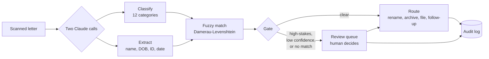

# Meridian Mailroom

An AI mail-triage pipeline for a disability law firm, shown as a working internal tool.
Incoming scanned mail is classified, has its identifiers extracted, is fuzzy-matched to
the right client, and is routed automatically, except for high-stakes letters, which are
held for a human before anything happens to them.

**Everything here is synthetic.** Fictional firm, fictional agency, invented people, no
real client data.

## Why this exists

Law firms drown in mail. A disability practice gets denials, award notices, hearing
notices, exam appointments, records requests, and overpayment letters, hundreds a week,
each of which has to be read, filed under the right client and matter, and acted on
before a deadline slips. This is the pattern I build for that problem, reduced to its
architecture and rebuilt on synthetic data so it can be shown in public.

The interesting parts are the ones that keep it safe:

- **A human-review gate that fires before any action.** Denials, awards, appeal
  deadlines, good-cause letters, and overpayments never auto-route. Neither does anything
  the classifier is unsure about, or any letter it cannot match to a client. Those divert
  to a review queue with the model's tentative read attached, so a person decides.
- **Fuzzy matching that survives OCR.** Scanned mail is full of typos. "R0bert Castiilo"
  still has to reach Robert Castillo's matter. A hand-rolled Damerau-Levenshtein matcher
  handles the noise, and a date-of-birth tiebreak disambiguates near-duplicate names.
- **An append-only audit log.** Every run and every review decision writes one immutable
  row with real token counts and durations, the trail you need for reconciliation and
  cost tracking.

## How it works



The classify and extract stages call Claude (`claude-sonnet-5`) with structured output;
everything after is deterministic, pure functions over the data. One async generator
(`lib/pipeline.ts`) drives the whole thing, so the live path and the recording script emit
the exact same events.

**What the model does, and what it doesn't.** The LLM has exactly one job here: read a
letter and return a category and some fields, behind a structured-output boundary. It makes
no decisions about what happens next. Everything that makes this a system is ordinary code
in [`lib/`](lib): the [Damerau-Levenshtein matcher](lib/fuzzy.ts) (hand-written and
[tested](lib/fuzzy.test.ts)), the [review gate](lib/pipeline.ts), the routing, the audit
log, and the pipeline that wires them together. The interesting engineering is in treating
the model as one unreliable component and building the deterministic, reviewable machine
around it.

## Running it

```bash
npm install
npm test           # the fuzzy matcher's tests
```

To re-capture the recorded runs
after changing letters or prompts: `ANTHROPIC_API_KEY=... npx tsx scripts/record-runs.ts`.

## What the production version adds

This is a demo of the *shape*. A real deployment for a firm is a different animal, and
that gap is the point:

- **Real intake.** Fax and scan-vendor webhooks, Drive/inbox watchers with channel
  renewal, a cron sweep so nothing is missed.
- **Real writes.** Instead of computing a filename, it renames and moves the document,
  updates the matter in the practice-management system (Clio and others), sets custom
  fields, calendars deadlines, and creates tasks.
- **Durable everything.** A real audit store, alerting when a system goes quiet, staged
  `DRY_RUN` rollout, per-firm taxonomy tuning, retries with idempotency.
- **Hosting and reliability.** Someone runs it, watches it, and fixes the edge cases that
  quietly break a no-code flow.

That layer, the integrations, the hardening, the operation, is the work. This repo
deliberately does not include it.

## License

[PolyForm Noncommercial 1.0.0](LICENSE). Read it, learn from it, fork it for noncommercial
use. It is a demo, not a product, and it ships without production deployment docs on
purpose.
